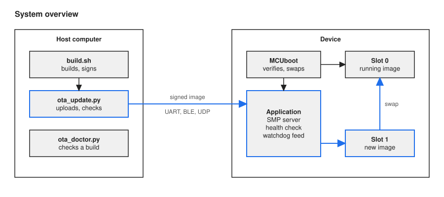
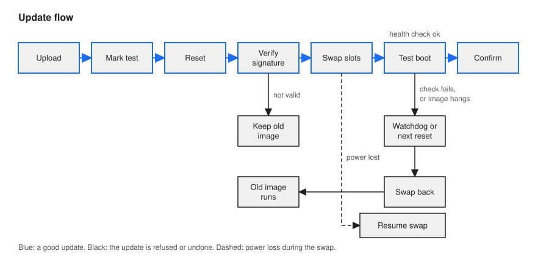
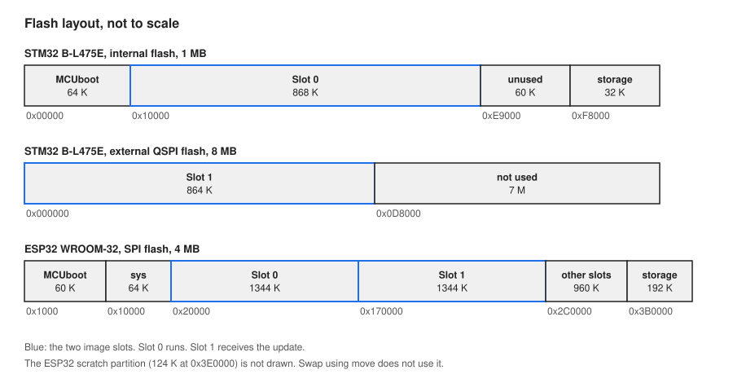
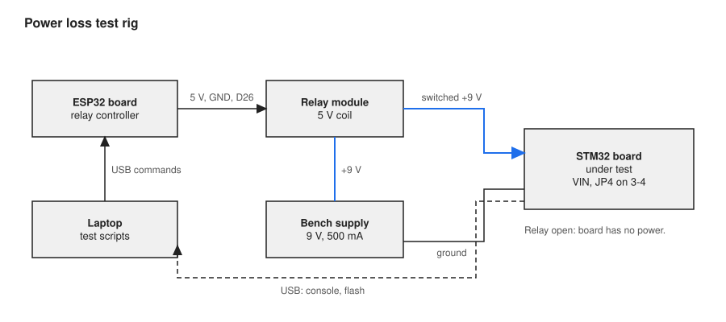

# OTA kit: signed firmware updates with rollback for Zephyr and MCUboot

The OTA kit is a Zephyr module that lets a device receive new firmware over UART, Bluetooth LE or Wi-Fi.
The bootloader starts only firmware that carries your signature.
If the new firmware does not prove that it works, the device goes back to the old firmware without help.



This is the public copy of the project. See [About this repository](#about-this-repository).
The how-to text in this file is written in the style of Simplified Technical English.

## Where it is useful, and where it is not

Use the kit when:

- You build a Zephyr application with sysbuild and MCUboot.
- The device must take an update in the field, with no debug probe.
- You want to see each failure case on real hardware before you trust the update path.

Do not use the kit as it is when:

- The device is a product. This is a demonstration project. It is not certified and not reviewed by other people.
- An attacker can touch the device. The debug port is open, and the firmware can be replaced with a probe.
- The update channel is not trusted. Read [Open risks](#open-risks) first.

## Terms

Each term has one meaning in this repository.

| Term | Meaning |
|---|---|
| Image | One firmware file with an MCUboot header. The build makes it. |
| Signature | A number that is calculated from the image with your private key. MCUboot has the public key and refuses an image whose signature does not match. The kit uses ECDSA P256. |
| Slot | A flash partition that holds one image. Slot 0 holds the image that runs. Slot 1 receives the new image. |
| Swap | MCUboot exchanges the contents of slot 0 and slot 1. The new image then runs from slot 0, and the old image is kept in slot 1. |
| Trailer | A small area at the end of each slot. MCUboot writes the swap progress there, the request to test an image, and the confirm flag. |
| Test boot | The first start of a new image after a swap. The image is not permanent yet. |
| Health check | A function in your application that returns true when the device works. The kit calls it 5 seconds after a test boot. |
| Confirm | The kit sets the confirm flag in the trailer. From then on the image is permanent. |
| Revert | At the next reset, MCUboot swaps an image that was not confirmed back out. The old image runs again. |
| Watchdog | A hardware timer that resets the device when the software stops restarting it. MCUboot starts it. The application takes it over. |
| SMP | The Simple Management Protocol of Zephyr. The host uses it to upload an image, to read the slot state and to reset the device. |

## How an update works



1. The host uploads the signed image. The application writes it to slot 1.
2. The host marks the image for a test and resets the device.
3. MCUboot verifies the signature. An image that is not valid is not started.
4. MCUboot swaps the slots and starts the new image one time.
5. The health check runs. If it returns true, the kit confirms the image.
6. If the image is not confirmed, MCUboot reverts it at the next reset. A watchdog causes that reset when the image hangs.

Why it works this way: a new image can be wrong in ways that a signature does not show.
The test boot lets the image prove that it works before the old image is given up.

Example from this kit: a test image that never confirms itself ran one time on the ST board. After the next reset, MCUboot printed `Swap type: revert` and version 1.0.0 ran again.

## How to use it

You need:

- A Zephyr workspace at `~/zephyrproject`, with the Python environment in `~/zephyrproject/.venv` and the Zephyr SDK.
- The Zephyr revision that `west.yml` names. Other revisions were not tried.
- A supported board. See [Boards and transports](#boards-and-transports).
- For the ST board: OpenOCD, and the board on its ST-LINK USB port as `/dev/ttyACM0`.

The versions that were used are in [docs/SETUP.md](docs/SETUP.md).

Do these steps one time:

```sh
git clone REPLACE_WITH_REPOSITORY_URL ota-kit && cd ota-kit
source ~/zephyrproject/.venv/bin/activate
pip install smpclient
imgtool keygen -k keys/ota_signing.pem -t ecdsa-p256
```

`REPLACE_WITH_REPOSITORY_URL` is a placeholder for the address of this repository.
The last command makes your private signing key. The file is ignored by git.

**WARNING: Keep `keys/ota_signing.pem` secret. A person who has this file can sign firmware for your devices.**

### Case A: update a device that already runs the kit

The device runs an image that was built with the kit. You want to install a newer version.

1. Build the new version. The number is the version of the image.

   ```sh
   scripts/build.sh 1.1.0
   ```

   The signed image is `build/v1.1.0/app/zephyr/zephyr.signed.bin`.

2. Check the build. The doctor reads the build folder and reports configuration mistakes.

   ```sh
   scripts/ota_doctor.py build/v1.1.0
   ```

   Do not continue if the report shows `FAIL`.

3. Send the image. Use the line for your transport.

   **WARNING: The device resets during this step. Make sure that the device can stop its work.**

   ```sh
   scripts/ota_update.py build/v1.1.0/app/zephyr/zephyr.signed.bin                    # UART, port /dev/ttyACM0
   scripts/ota_update.py build/ble-v1.1.0/app/zephyr/zephyr.signed.bin --ble ota-kit  # Bluetooth LE
   scripts/ota_update.py build/esp32-wifi-v1.1.0/app/zephyr/zephyr.signed.bin --udp ADDRESS --port /dev/ttyUSB0   # Wi-Fi, ESP32
   ```

   For Bluetooth LE, build with `VARIANT=ble scripts/build.sh 1.1.0` and pair the host with the device first.
   For Wi-Fi on the ESP32, build with `BOARD=esp32_devkitc/esp32/procpu VARIANT=wifi scripts/build.sh 1.1.0`. `ADDRESS` is the address that the device prints when it joins the network.
   Wi-Fi on the ST board uses a relay script on the host and has an open defect. [docs/TRANSPORTS.md](docs/TRANSPORTS.md) gives the commands.

4. Read the last line of the output.

   - `RESULT OK: running v1.1.0` means that the image was confirmed.
   - `RESULT ROLLED BACK` means that MCUboot reverted the image. The old version runs.
   - `RESULT FAIL` means that the script could not see a confirm. Read the slot state in the lines above it.

The version must be higher than the version that runs. MCUboot refuses a lower version at the next start.

### Case B: add the kit to your Zephyr application

Your application does not have an update path yet. You add the kit, then you flash the device one time with a probe or a cable.

1. Register a health check. The kit confirms a new image only when this function returns true.

   ```c
   #include <ota_kit/ota_kit.h>

   static bool health_ok(void) { return my_sensor_answers(); }

   int main(void)
   {
   	ota_kit_set_health_check(health_ok);   /* no check registered means no confirm */
   	/* your application */
   }
   ```

   Make the check test the functions that the device needs. A check that always returns true confirms a bad image.

2. Build your application with the `ota-kit` snippet. The snippet turns on the kit and configures MCUboot.

   ```sh
   west build -b <board> --sysbuild -S ota-kit <your app> -- \
     -DEXTRA_ZEPHYR_MODULES=/abs/path/to/ota-kit \
     -DSB_CONFIG_BOOT_SIGNATURE_KEY_FILE=\"/abs/path/to/ota-kit/keys/ota_signing.pem\"
   ```

   Add `-S ota-kit-ble` for Bluetooth LE, `-S ota-kit-wifi` for Wi-Fi on the ESP32, or `-S ota-kit-wifi-dial` for Wi-Fi on the ST board.

3. Check the build with the doctor before you flash it.

   ```sh
   scripts/ota_doctor.py <build folder>
   ```

   The doctor checks the partitions, the sector sizes, the image size, the watchdog timeouts, the signing key and more.
   A report with no `FAIL` does not prove that the board is safe. The rules and their limits are in [docs/DOCTOR.md](docs/DOCTOR.md).

4. Flash MCUboot and the first image.

   **WARNING: On the ESP32, `--erase` erases the full flash. A Wi-Fi network that is stored on the board is erased too.**

   **WARNING: A board with Wi-Fi keeps the network name and the passphrase in its flash as plain text. Erase them before you give the board to another person.** [docs/TRANSPORTS.md](docs/TRANSPORTS.md) and [docs/BOARD_ESP32.md](docs/BOARD_ESP32.md) give the commands.

   ```sh
   (cd ~/zephyrproject && west flash -d /abs/path/to/build --runner openocd)                      # ST board
   (cd ~/zephyrproject && west flash -d /abs/path/to/build --esp-device /dev/ttyUSB0 --erase)    # ESP32, first flash
   ```

5. From now on, use Case A.

A new board needs correct partitions, one sector size for the two slots, and a watchdog. [docs/PORTING.md](docs/PORTING.md) gives the steps.
The ESP32 needs three more steps: radio files from Espressif, one patch, and the Wi-Fi network. [docs/BOARD_ESP32.md](docs/BOARD_ESP32.md) gives them under "How to build and update over Wi-Fi".

### Which of these commands were run

| Command | Status |
|---|---|
| `imgtool keygen`, `scripts/build.sh`, `scripts/ota_doctor.py` | Run from a new clone on 2026-10-07, for the ST board and the ESP32. No hardware. |
| `scripts/ota_update.py` with UART, `--ble` and `--udp` | Run on the boards during the tests. Not run again for this text. |
| `west flash` for the two boards | Run on the boards during the tests. Not run again for this text. |
| `west build -b <board> --sysbuild -S ota-kit <your app>` | Not run in this exact form. `scripts/build.sh` runs the same command for the example application. |

## Flash layout



MCUboot needs two slots with the same sector size. A sector is the smallest area that the flash can erase.

- ST B-L475E-IOT01A: slot 0 is in the internal flash. Slot 1 is in the external QSPI flash. The kit makes MCUboot use 4 K sectors on both.
- ESP32 WROOM-32: the two slots are in the one SPI flash, 1344 K each.

The kit uses the MCUboot mode "swap using move". This mode needs one free sector in slot 0, so the largest image is smaller than the slot.
On the ST board the build stops when an image is too large. On the ESP32 it does not.

Details: [docs/SETUP.md](docs/SETUP.md) for the ST board, [docs/BOARD_ESP32.md](docs/BOARD_ESP32.md) for the ESP32, [docs/PORTING.md](docs/PORTING.md) for a new board.

## Boards and transports

Only results from hardware are in this table. "Tested" and "supported" mean that the failure suite passed and that measured update runs passed.

| Board | Transport | Status | Evidence |
|---|---|---|---|
| ST B-L475E-IOT01A (`disco_l475_iot1`) | UART | **Tested.** Failure suite 11 of 11, 20 of 20 measured runs, near full slot image, 60 power cuts with no board lost | [RESULTS.md](docs/RESULTS.md), [POWERLOSS.md](docs/POWERLOSS.md) |
| ST B-L475E-IOT01A | Bluetooth LE, encrypted link | **Tested on earlier firmware.** Failure suite twice (8, then 9 cases), 20 + 5 measured runs. Not run again after the later changes | [TRANSPORTS.md](docs/TRANSPORTS.md), [RESULTS.md](docs/RESULTS.md) |
| ST B-L475E-IOT01A | Wi-Fi, connected UDP socket through a relay script | Partial. Failure suite 10 of 10 on the second pass. Defect: 3 of 10 update runs in the second series stopped during the upload, cause not found. No encryption, no authentication | [TRANSPORTS.md](docs/TRANSPORTS.md) |
| ESP32 WROOM-32 (`esp32_devkitc/esp32/procpu`) | Wi-Fi, SMP over UDP | **Supported on this evidence:** failure suite clean in four passes, 30 of 30 measured runs, and 5 of 5 on a build with the HAL patch. One day, one network. No encryption, no authentication | [BOARD_ESP32.md](docs/BOARD_ESP32.md) |
| ESP32 WROOM-32 | UART | Partial. Updates, rollback and watchdog work. One request in about 100 uploads got no answer, cause not found | [BOARD_ESP32.md](docs/BOARD_ESP32.md) |
| ESP32 WROOM-32 | Bluetooth LE | Not tested. Two updates worked, the suite was not run | [BOARD_ESP32.md](docs/BOARD_ESP32.md) |
| `nrf52840dk/nrf52840`, `native_sim` | none | Compile only. The nRF build was never flashed. The `native_sim` sample runs, with no bootloader and no update | [RESULTS.md](docs/RESULTS.md), [DOCTOR.md](docs/DOCTOR.md) |

One board of each type was used. Results in short, the security model and the known limits are in [docs/REFERENCE.md](docs/REFERENCE.md).

## Power loss testing



A power loss during a swap is the most dangerous moment of an update: the two slots are half exchanged.
MCUboot writes its progress to the trailer, so it can continue the swap at the next start.

The test rig proves this on the ST board. A relay cuts the supply of the board at a selected moment. A script then checks which image starts.

Result: 60 cuts during upload, swap, revert, confirm and erase. The board started a complete image each time, old or new, with no help.
Limits: the cut was clean, and the image was small. A slow supply drop and a large image were not tested.

The rig, the method, the results and the limits are in [docs/POWERLOSS.md](docs/POWERLOSS.md). The test needs the rig: `tests/powerloss.py`.

## Open risks

Read these before you use the kit.

1. **The debug port is open.** Readout protection is off. A person with a probe can read the firmware and the keys, and can replace the bootloader. All other protections assume that this does not occur.
2. **Power loss is tested only in its simplest form.** See the limits above. The swap also uses an MCUboot option that is marked experimental upstream.
3. **There is no safe state check.** The device resets and swaps when the host tells it to. The device does not look at its own work first.
4. **An image that stops before `main()` makes the device do nothing for about 30 seconds.** MCUboot starts a watchdog that stays active when the application starts. The watchdog resets the device after about 30 seconds, and MCUboot reverts the image. This was measured on the two boards: 2 of 2 runs on the ST board, 3 of 3 on the ESP32. Before this watchdog was set up on the ESP32, the board stayed stopped until a person reset it. Only a small number of runs support the result.
5. **The update channels are not authenticated.** A person on the UART or on the Wi-Fi network can upload, erase and reset. That person cannot make an image start that you did not sign.
6. **Wi-Fi on the ST board is not reliable.** In the last series, 3 of 10 uploads stopped and the cause was not found. Do not use this transport for a device that you cannot reach by cable.

The full analysis is in [docs/HAZARDS.md](docs/HAZARDS.md). The security model is in [docs/REFERENCE.md](docs/REFERENCE.md).

## Contributing

Reports and changes are welcome. [CONTRIBUTING.md](CONTRIBUTING.md) gives the rules, and [SECURITY.md](SECURITY.md) tells you how to report a security problem.
Findings that belong to Zephyr, MCUboot or the Espressif HAL are in [docs/UPSTREAM.md](docs/UPSTREAM.md).

## License

Apache-2.0. See [LICENSE](LICENSE). This is the same license as Zephyr and MCUboot. Licenses of other parties, and the contents of the test fixtures, are in [NOTICE](NOTICE).

## About this repository

- This is the public copy of the project.
- The work was done during several weeks in a private repository, on real hardware: an STM32 board and an ESP32 board.
- This repository was built from the final files of the private repository, in a small number of commits that are grouped by topic. Its history does not show the order or the dates of the real work.
- The raw data from the real runs is in `docs/data`. The test logs are in `tests/logs`.
- Later results were added in a second small group of commits: Wi-Fi on the STM32 board, and one more test of the ESP32 build.
